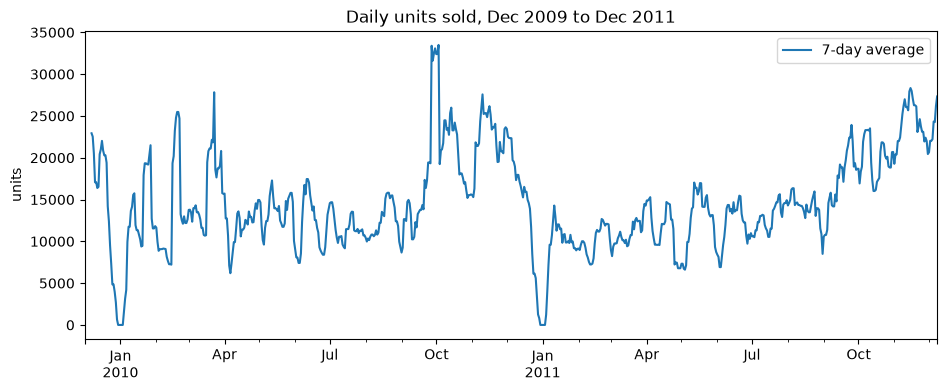
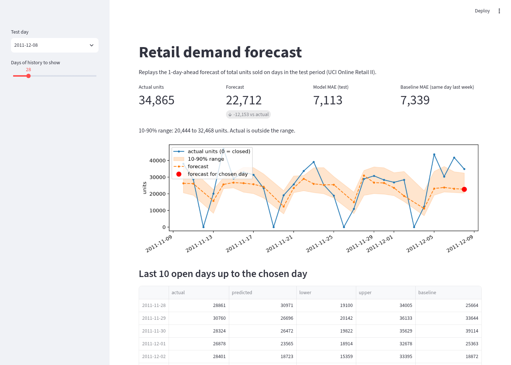
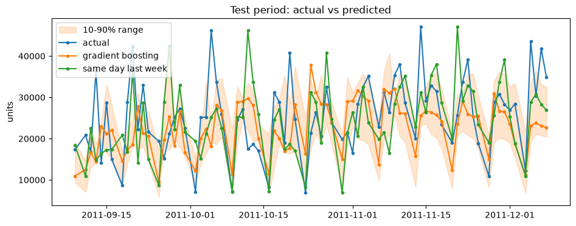
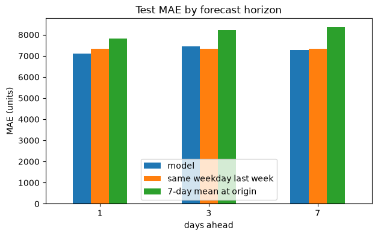

# Retail demand forecast

A 1-day-ahead forecast of total units sold per day, to help an online gift retailer plan stock and staff.

Data: two years of real transactions from a UK online gift shop, the [UCI Online Retail II](https://archive.ics.uci.edu/dataset/502/online+retail+ii) dataset (1 Dec 2009 to 9 Dec 2011). On the last 3 months, a gradient boosting model trained on log units gets MAE 7,113 units/day against 7,339 for a "same day last week" baseline, about 3% better. The gain is small because a few huge wholesale orders cannot be predicted from past daily totals. The sections below show where the model goes wrong.



## Demo



The app replays the 1-day-ahead forecast on days in the test period: pick a day and it shows the prediction made from earlier days next to what actually sold. It is not a live forecast of tomorrow.

## Run

Python 3.12+.

```
python -m venv .venv
source .venv/bin/activate
pip install -r requirements.txt
mkdir -p data
curl -L -o data/retail.zip https://archive.ics.uci.edu/static/public/502/online+retail+ii.zip
unzip data/retail.zip -d data
python train.py
pytest
streamlit run app.py
```

Reading the Excel file takes about 30 seconds. `train.py` saves the model, the metrics, the test predictions and the two charts. The app needs those, so run `train.py` first.

## What it does

1. Cleaning: drops exact duplicate rows, removes each cancelled order line together with its original order (see below), drops the remaining cancelled invoices (Invoice starts with C), rows with quantity or price <= 0, and stock codes that are not products (postage, manual entries, fees, gift vouchers).
2. Target: total units sold per day. Every calendar day is filled in, with 0 on days the shop was closed (Saturdays, Christmas), so lag 7 is always the same weekday last week.
3. Features from the past only: day of week, month, units 1, 7 and 14 days ago, and the mean of the previous 7 and 28 days.
4. Closed days are left out of training and scoring, because predicting 0 on a Saturday is trivial and would flatter every method.
5. The file stops at 12:50 on 9 Dec 2011, while other recent weekdays run to about 18:00. That half day is cut, so the data ends on 8 Dec.
6. Split by time: the last 91 days are the test set. Nothing is shuffled.
7. Model: `HistGradientBoostingRegressor`, trained on raw units and on log1p(units), compared with two baselines. Two quantile models add a 10-90% range.

## Results

1,067,371 raw rows, 995,377 after cleaning and cutting the partial last day. 504 open days for training, 78 for testing (2011-09-09 to 2011-12-08).



| Method | MAE | RMSE | MAPE |
|---|---|---|---|
| Same day last week | 7,339 | 9,540 | 32.1% |
| Mean of last 7 days | 7,835 | 10,030 | 35.3% |
| Gradient boosting, raw units | 7,446 | 9,583 | 32.0% |
| Gradient boosting, log units (saved) | 7,113 | 9,318 | 29.7% |

Log target vs raw target: the choice is made by 5-fold time-series CV on the training period only. Log units won on average (MAE 5,347 against 6,197) and in each of the 5 folds, but the margin per fold ranged from 40 to 1,976 units, and the log model's fold MAEs ranged from 3,946 to 7,885. The standard deviation across folds (about 1,340) is larger than the average gap (850), so this is a modest, not a decisive, win. On the test set the log model is also better on all three metrics. Training on logs makes the model care less about the biggest days, which helps on typical days.

## Forecast range

Two extra models (`loss="quantile"`, quantiles 0.1 and 0.9, same features, same log target as the saved model) give a 10-90% range for each day. If the range were well calibrated, about 80% of days would fall inside it.

On the 78 test days only 60% fall inside, with an average width of 12,401 units. The range is too narrow: 21 days are above it and 10 below. It is fit on the training period, and the busy autumn in the test set is more volatile than most of what the model saw. Treat it as a rough guide, not a reliable 80% interval. The orange band in the chart above shows it.

## Forecast horizon

The same setup, with one model per horizon: a forecast made at the end of day t for day t+h. Every feature comes from day t or earlier, except the calendar (day of week and month of the target day). Log or raw target is picked by time-series CV on the training period for each horizon. All three are scored on the same 78 test days. The baselines use only what is known on day t: the same weekday one week before the target day, and the mean of the 7 days up to t.

| Days ahead | Model MAE | Same weekday last week | 7-day mean at origin | Gain vs best baseline |
|---|---|---|---|---|
| 1 | 7,113 | 7,339 | 7,835 | 3.1% |
| 3 | 7,459 | 7,339 | 8,218 | -1.6% |
| 7 | 7,279 | 7,339 | 8,358 | 0.8% |

The gain does not grow with the horizon. At 3 days ahead the model is slightly worse than "same weekday last week", and at 7 days it is about level with it, so for this shop the weekly pattern carries most of what can be predicted from past totals.



## What it gets wrong

The 5 worst test days are all big underpredictions:

| Date | Actual | Predicted | Biggest single invoice |
|---|---|---|---|
| 2011-10-05 | 46,146 | 18,040 | 7,020 |
| 2011-09-20 | 42,401 | 18,493 | 11,816 |
| 2011-10-20 | 40,769 | 17,708 | 13,392 |
| 2011-09-13 | 36,492 | 14,362 | 7,824 |
| 2011-11-14 | 47,043 | 25,594 | 13,956 |

On each of these days the biggest single invoice was 7,020 to 13,956 units. Large orders like these are not visible in past daily totals, so the model cannot see them coming.

## A bug I found and fixed

The first version of the cleaning dropped cancellation rows (invoices starting with C) but kept the original orders they cancelled, so the data counted demand that never happened. One example: an order of 80,995 units of "PAPER CRAFT , LITTLE BIRDIE" on 9 Dec 2011, cancelled 12 minutes later by invoice C581484. It showed up as the worst forecast error in the test set.

The fix: for each cancellation, remove the most recent earlier order line with the same customer, stock code and quantity. This matched 6,402 of 18,390 cancellations that have a Customer ID and removed 405,553 units of fake demand. A test checks that an order and its cancellation are both removed.

The test results above are not compared with the version before the fix, because the fix changed the test data itself, so the two sets of numbers are not measuring the same thing. (9 Dec is also no longer scored, since it is a partial day.)

## Limitations

- Only one autumn and Christmas season is in the test set, so the numbers come from 78 days.
- Only exact cancellations are matched. Partial cancellations, and cancellations with no Customer ID, are dropped without removing their original order, so some fake demand remains.
- The model predicts the whole shop's total, not per product, and has no price, promotion or customer features.
- UK bank holiday features were tried and made CV worse, so they are not used.
